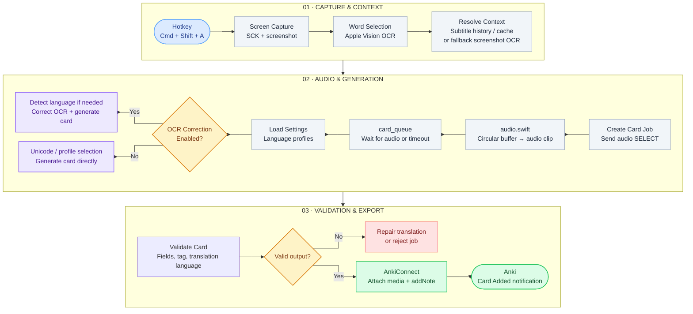

# Snap (BETA)
This is an add-on for Anki, which makes the process of creating cards faster while watching videos in a foreign language. You don't need to take multiple screenshots and search for information. It will capture information from your screen.

The example of a card

# How does this work?

https://github.com/user-attachments/assets/66e97406-e0f7-4398-a40a-6c5de6095eee

# Where are the settings?
Tools → Snap

